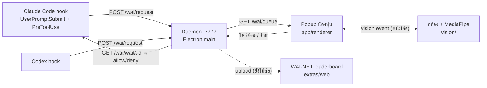

# hwAI ไหว้กูซะ (hwAI-suay-ruay-token)

AI กำลังจะยึดโลก มนุษย์ที่อยากรอดต้อง **ไหว้** มันก่อนใช้งาน
ทุกครั้งที่ส่ง prompt หรือ AI แตก subagent ใน Claude Code / Codex จะมีน้องหุ่นเด้งขึ้นขอบจอว่า "มนุษย์ ไหว้กูซะ"
ไหว้สวยก็ได้ใช้ ไหว้ไม่สวยก็โดนด่า ไหว้แย่หลายรอบเข้า AI จะงอนจนต้องไหว้พระ (Lv3) ขอขมา

> สถานะ: **hackathon, ยังเป็น spike/prototype** · ตอนนี้ยังไม่มีกล้องจริง ใช้ปุ่ม "ข้าม (dev)" แทนการไหว้
> รันได้บน mac · Windows กำลังทำ ยังไม่ได้ทดสอบบนเครื่องจริง ([รายละเอียด](spikes/popup-hook/README.md#windows-ยังไม่ได้ทดสอบบนเครื่องจริง))

## ลองเลย (mac)

ต้องมี Node.js (LTS) · ปิด `prototype/agent-popup/server.py` ก่อน เพราะใช้ port 7777 เหมือนกัน

**แบบแอป (กดเปิดจาก Spotlight)**
```bash
bash spikes/popup-hook/install-shortcut.sh     # สร้าง ~/Applications/ไหว้กูซะ.app
```
Cmd+Space พิมพ์ "ไหว้กูซะ" · เปิดครั้งแรกจะมี onboarding (กล้อง, ต่อ Claude Code/Codex) · log: `~/Library/Logs/wai-kusa.log`

**แบบ dev (2 terminal)**
```bash
npm --prefix app/renderer install && npm --prefix spikes/popup-hook install
npm --prefix app/renderer run dev              # terminal 1: หน้าตา :5173
npm --prefix spikes/popup-hook start           # terminal 2: daemon :7777 + popup + tray 🙏
```

อยากดูแค่ UI ไม่ต้องมี daemon: `npm --prefix app/renderer run dev:mock` แล้วเปิด http://localhost:5173/debug.html

## ต่อกับ Claude Code / Codex

ตอน dev ติด hook **เฉพาะใน `~/wai-sandbox`** เท่านั้น (กฎทีม: ห้ามติดแบบ global เดี๋ยว Claude Code ของตัวเองพัง)

1. ติ๊ก Claude Code / Codex ใน onboarding (หรือกด ⚙ ในหน้าหลัก) → แอป merge hook ลง `~/wai-sandbox/.claude/settings.local.json` และ `~/wai-sandbox/.codex/hooks.json`
2. Claude Code: `cd ~/wai-sandbox && claude` แล้วส่ง prompt อะไรก็ได้ → popup เด้ง → กดข้าม → AI ตอบ
3. Codex: ต้อง trust hook ก่อน ไม่งั้น Codex ข้ามเงียบๆ → กดปุ่ม "อนุญาต hook ของ Codex" ในหน้าหลัก (เปิด Terminal รัน Codex CLI ให้) พิมพ์ `/hooks` แล้วกด trust · trust ครั้งเดียวใช้ได้ทั้ง CLI และแอป Codex

ปิดชั่วคราว: ติ๊กออกที่ tray / สวิตช์ในหน้าหลัก หรือรัน AI ด้วย `WAI_BYPASS=1` · daemon ไม่ได้เปิด = ผ่านเลย (fail-open)

## ทำงานยังไง



- hook ยิงคำขอเข้า daemon แล้ว long-poll รอผล · ผ่าน = exit 0 (AI ทำงาน) · ไม่ผ่าน = exit 2 (บล็อก)
- 1 การไหว้ = ปลด 1 การ์ด (1 prompt หรือ 1 subagent) · รอได้สูงสุด 300 วิ
- state ความโกรธ: RETRY → ANNOYED (หน้าต่างหนีเมาส์) → SULKING → RAGE_QUIT → FORGIVE (ไหว้ Lv3) · UI ทำแล้วแต่ยังขับด้วย mock

## แผนที่ repo

| โฟลเดอร์ | คืออะไร | เจ้าของ | สถานะ |
|---|---|---|---|
| `artifact.md` | แผนทีม: architecture, state machine, 6 บทบาท, contract API, milestone | ทั้งทีม | แผน |
| `spikes/popup-hook/` | daemon :7777 + popup + tray + onboarding + hook + installer | Front (ชั่วคราว) | spike รันได้จริง |
| `app/renderer/` | หน้าตาทั้งหมด (Avatar, หน้าหลัก, overlay กล้อง, debug) | Front (#2) | ใช้จริงกับ spike |
| `app/main/` | daemon ตัวจริง | #1 Core | ยังไม่มี |
| `integrations/` | hook, shell wrapper, browser extension ตัวจริง | #4 | ยังไม่มี |
| `vision/playground/` | MediaPipe ตรวจท่าไหว้ + level 0–3 + เครื่องอัดท่า | #3 Vision | prototype |
| `voice/` | edge-tts เสียงไทย | #5 | ยังไม่มี |
| `extras/web/` | WAI-NET: leaderboard, โอกาสรอด, public API + SDK | #6 | รันได้กับ mock |
| `characters/jason/` | น้อง Jason (SVG ทุก mood) | ทีม design | asset |
| `prototype/` | agent popup + MediaPipe Lab รุ่นแรก (ใช้ :7777 ชนกับ daemon) | ทีม | prototype |

## อ่านต่อ

- [HANDOFF.md](HANDOFF.md) · ใครต้องทำอะไรต่อ, contract ที่ยังค้าง, วิธีทดสอบ
- [spikes/popup-hook/README.md](spikes/popup-hook/README.md) · รัน spike, tray, shortcut, Windows, onboarding
- [spikes/popup-hook/INSTALL_PLAN.md](spikes/popup-hook/INSTALL_PLAN.md) · แผนทำ installer
- [app/renderer/FRONT_RULES.md](app/renderer/FRONT_RULES.md) · กฎ UI, CI, state → UI
- [extras/web/README.md](extras/web/README.md) · leaderboard
- Figma: [FigJam (user stories, user flow)](https://www.figma.com/board/aE8SJfnfhvaX20YNWKFNzu) · [Design system (กำลังทำ)](https://www.figma.com/design/eLfijCYA977r1xsTk3K8GR)
